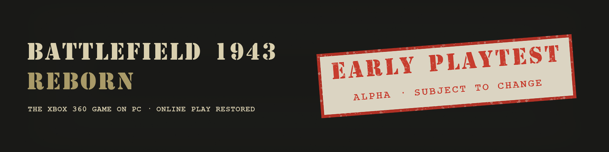

<p align="center">
  <a href="https://recomplauncher.com/game/battlefield-1943-reborn"><picture><source media="(prefers-color-scheme: dark)" srcset="https://recomplauncher.com/assets/press/launcher/badge-light.svg"></picture></a>
  <br>
  
</p>

> [!WARNING]
> **Alpha playtest.** Battlefield 1943 Reborn is in early playtesting. Expect bugs, crashes and big changes between
> builds, and stats that reset. Tell us what you find on our [Discord](https://discord.gg/8eakYSvBZS).

# Battlefield 1943 Reborn

Battlefield 1943, the 2009 Xbox 360 game by DICE, running natively on Windows and Linux, with its online multiplayer
brought back on servers that anyone can run.

This is a fan project by TekRantGaming. It is not made, endorsed or supported by Electronic Arts or DICE. It contains
no game files: you need your own copy of the Xbox 360 game (Xbox Live Arcade, title ID `5841097E`).

**Latest build: [0.4.0](../../releases/latest)** (Windows and Linux) &nbsp;·&nbsp; **Discord: [discord.gg/8eakYSvBZS](https://discord.gg/8eakYSvBZS)**

- [Download and play](#download-and-play)
- [Requirements](#requirements)
- [Features](#features)
- [Controls](#controls)
- [Settings](#settings)
- [Online play and servers](#online-play-and-servers)
- [Known issues](#known-issues)
- [How it works](#how-it-works)
- [Source code](#source-code)
- [Privacy](#privacy)
- [Credits and licences](#credits-and-licences)
- [Legal](#legal)

## Download and play

**Windows**
1. Download `BF1943-Reborn-<version>-windows-x64.zip` from the [Releases](../../releases/latest) page and unzip it
   somewhere you can write to (for example `C:\Games`, not Program Files).
2. Start `bf1943.exe`.

**Linux**
1. Download `BF1943-Reborn-linux-x86_64.AppImage` from the [Releases](../../releases/latest) page into a folder of its
   own (for example `~/Games/BF1943-Reborn`): its `game` and `user` folders go beside it.
2. Make it runnable (`chmod +x` on the file, or Allow executing in its properties) and start it.

Its name is the same in every release. Updates install themselves; to update by hand, put the new file over the old one
(not in Downloads), so your settings, game files and Steam shortcut stay.

**Then, on both**
1. The first time, select your own Battlefield 1943 (Xbox 360) package: the single file in `5841097E\000D0000` from
   your console's storage, or a folder that holds it. It is installed into the folder `game`, once. The first start
   then prepares the game's shaders, so effects do not stutter the first time you see them.
2. Choose your name, then press **Play**.
3. **Quick Play** joins the busiest server with room, or pick one in the **Server Browser**.

Your settings, logs and crash reports stay in the folder `user` next to the game.

**Updates install themselves.** At every start the game looks at this page's latest release; a newer one is downloaded,
checked against the release's `SHA256SUMS.txt`, installed and started. On Windows only the files that changed are
replaced, and if any of them cannot be, every one is put back; on Linux the AppImage replaces itself. Your `game` and
`user` folders are never touched. The servers only let the newest version in: when a newer one is out, the game says
so, with **Update now**. Builds before 0.2.0 cannot update themselves: download the latest build once and unzip it
over your folder (Windows), or put the AppImage in place of the old one (Linux).

If Windows says *"rexruntime.dll is either not designed to run on Windows or it contains an error"* (Bad Image,
0xc0e90002), it is not a broken download: the builds are not code signed yet, and Windows 11's Smart App Control has
not cleared this build's files.

## Requirements

- Windows 10 or 11, 64 bit; or Linux on x86_64 with glibc 2.38 or newer, an X11 or XWayland session, and `curl` for
  updates (SteamOS, Bazzite and current desktop distributions; tested on a ROG Ally with Bazzite).
- A graphics card with Vulkan (NVIDIA GTX 10 series, AMD RX 5000 series, Intel Arc or newer recommended; on Linux,
  Mesa's RADV or NVIDIA's driver).
- Your own copy of Battlefield 1943 for Xbox 360: its package file from your console.
- To host a server: Windows (10, 11 or Server). The server download brings everything else.

## Features

**The game**
- All four maps: Wake Island, Guadalcanal, Iwo Jima and Coral Sea.
- Up to 24 players a server, on foot, in jeeps, tanks, boats and planes, with the air raid, as in the original.
- Capture points lettered A to E: in the HUD, on the markers in the world, on the minimap and on the deploy map, and
  a map of the whole battle in the pause menu.
- The game's own tutorial (Help), and our Stats and Awards, Achievements and Leaderboards pages.

**Online**
- A server browser with the official servers and everyone else's (Community), each with its map, players, region
  and tick rate, a region filter, and Direct connect for a server that is not listed or runs on a LAN.
- **Quick Play** joins the busiest server with room.
- **Create Private Match**: a match on your own PC for you and your friends.
- Messages from a server to everyone on it, for an update or a restart.
- A server package for anyone to host their own dedicated servers, listed for everyone or kept to a LAN, managed
  from a page in the browser.

**On PC**
- A native Windows and Linux program with a Vulkan renderer, at your screen's resolution and refresh rate.
- Ultrawide screens: on 21:9, 32:9 and other wide screens the game fills the screen with a wider view, with the HUD
  at the screen's sides or kept in the middle.
- Any frame rate: a limit from 30 to 240 or none, and VSync. The game still runs its world 30 times a second as on
  the console, but the camera turns on every frame, and soldiers, vehicles and vehicle cameras move smoothly between
  the game's updates.
- Graphics presets from Potato to Ultra, for older and low end PCs as well as fast ones.
- Graphics: drawn at your display's resolution, or at a share of it scaled up and sharpened by AMD FSR 1 or NVIDIA
  Image Scaling (NIS), shadow quality up to four times the original, FXAA, sharpening (AMD CAS), texture filtering up
  to 16x, ambient occlusion (Intel's XeGTAO, with strength and quality settings) and global illumination (one bounce,
  with quality and distance settings).
- Grass and shrubs on Wake Island, Guadalcanal and Iwo Jima, placed from each level's own data, drawn as far as the
  whole map.
- Field of view on foot and in vehicles, motion blur on or off, camera shake and its strength, brightness and gamma.
- Keyboard and mouse beside controllers, with rebindable keys: the mouse aims vehicle guns and turrets directly,
  flies planes and looks around from a driver's or passenger's seat. The button prompts show what you play with, on
  foot and in vehicles, and change when you change between controller and keyboard.
- Volume for master, music, effects and voices, menu music and sounds.
- The game in English, French, German, Italian, Spanish or Japanese, and aim assist on or off.
- Proximity voice chat that both teams hear (hold B to talk, or open mic), and text chat to everyone, your team or
  your squad (T, Y, U), with a profanity filter.
- Performance metrics in the corner (off unless you turn them on; F2: off, FPS only or full), and crash and hang
  reports in `user\crashes`.
- Updates that install themselves (see [Download and play](#download-and-play)).
- Add to Steam from the launcher's Home, with the game's artwork.

## Controls

Keyboard and mouse are on by default, beside any controller. Every key can be changed in Settings > Controls >
Keyboard bindings.

| Key | On foot | In a vehicle |
|---|---|---|
| W A S D | move | W throttle, S brake, A D turn |
| Mouse | look and aim | aim the guns and turret; look around from a driver's or passenger's seat; fly a plane |
| Left mouse button | fire | fire |
| Right mouse button | aim down sights | second weapon (bombs in a plane) |
| Space | jump | change seat |
| E | enter a vehicle, use, pick up | get out |
| R | reload | |
| F | draw knife (the Infantry class's wrench) | |
| G | grenade, explosives | free look in a plane |
| Q or the mouse wheel | switch weapon | second weapon (bombs in a plane) |
| Shift | sprint | |
| C or Ctrl | crouch | |
| V or Up | | vehicle camera (the bomb sight in the air raid) |
| Tab | command (tap), score (hold) | the same |
| T, Y, U | chat to everyone, your team, your squad | the same |
| B | push to talk (hold) | the same |
| Esc or Enter | pause menu | pause menu |
| F2 | performance metrics | the same |

Planes: the mouse moves the stick. Left and right roll, forward and back pitch, and the stick springs back to the
centre when the mouse stops; W is the throttle, S the brake, A and D the rudder. Which way is up follows Vertical fly
(Settings > Controls > Game controls). On a controller planes fly as on the Xbox 360: left trigger throttle, right
stick pitch and roll, left stick rudder, right bumper bombs, left bumper free look.

Controllers: Xbox controllers play as on the console, with the game's own button layouts (Normal, Southpaw, Lefty)
for soldiers, land vehicles and planes. Button prompts can show Xbox 360, Xbox Series, PlayStation 3, PlayStation 5
or Steam Deck buttons, or the keys.

## Settings

Everything is in our Settings menu, from the main menu and the pause menu.

- **Display**: window mode (windowed or borderless), monitor, window size, resolution, refresh rate, aspect ratio
  (Fill screen, or Letterbox 16:9), HUD layout on wide screens (Edges or Centered), brightness, gamma, VSync, frame
  rate limit, field of view on foot and in vehicles, motion blur, camera shake.
- **Graphics**: graphics preset (Potato, Low, Medium, High, Ultra), antialiasing (FXAA), upscaler (Off, AMD FSR 1
  or NVIDIA NIS) and its mode, shadow quality,
  sharpness, texture filtering, ambient occlusion, global illumination, grass distance, HD textures.
- **Audio**: master, music, effects and voices volume, menu music and sounds, the game's sound system and
  voiceover language, voice chat (push to talk, open mic or off), voice volume, microphone sensitivity.
- **Controls**: Keyboard and mouse on or off, button prompts, camera turning (every frame or 30 times a second as on
  the Xbox 360), mouse sensitivity (with its own for aiming down sights and for vehicles), aim hold or toggle, mouse
  vertical and mouse vertical in vehicles, aim assist (for the controller and for keyboard and mouse), controller
  camera sensitivity, response, dead zone, inversion, vibration and its strength, button
  remapping, keyboard bindings, and the game's own control layouts, vertical look and vertical fly.
- **Gameplay**: your name, game language (English, French, German, Italian, Spanish or Japanese), text chat,
  performance metrics, and sharing (see [Privacy](#privacy)).

## Online play and servers

EA's servers for Battlefield 1943 are gone. Reborn brings online play back with its own main backend, which every
player logs in to and which lists every server.

- **Official servers** are run by TekRantGaming, in EU Central: eight with Wake Island, Guadalcanal and Iwo Jima in
  turn, one each for Wake Island, Guadalcanal and Iwo Jima around the clock, Air Superiority on Coral Sea, and an
  experimental 60 Hz test server with all four maps in turn.
- **Community servers**: anyone can host dedicated servers with `BF1943-Reborn-Server-<version>-windows.zip`, from a
  manager page in the browser. Each server has its own name, description, maps, players and pause between rounds,
  and shows in everyone's server browser under Community with its region; LAN only keeps it off the list. See
  [docs/SERVER.md](docs/SERVER.md).

## Known issues

This is an alpha. The main ones in 0.4.0:

- The first person weapon and hands still move 30 times a second at high frame rates (the view itself turns on every
  frame).
- Stats, awards and leaderboards are kept only while the official backend runs: they reset when it restarts.
- No HDR. On 16:10 and 4:3 screens Fill screen crops the picture's sides: Settings > Display > Aspect ratio >
  Letterbox 16:9 shows all of it.
- Linux: the Vulkan renderer needs X11 or XWayland (a Wayland only session falls back to a slower one); the game's
  tutorial (Help) can drop back to the menu at once; dedicated servers on Linux are not tested yet.
- Voice chat has no echo cancelling: with Open mic, use headphones. Push to talk and the chat keys are keyboard
  keys: with a controller only (Steam Deck, ROG Ally), use Open mic, or map a back button to B in Steam Input.
- The builds are not code signed yet (see [Download and play](#download-and-play)).
- HD textures can be imported (Settings > Graphics), but no texture pack has been published.

Report anything else on [Discord](https://discord.gg/8eakYSvBZS), with the files from `user\crashes` for a crash.

## How it works

- **Static recompilation.** The Xbox 360 program is translated ahead of time into native 64 bit code for Windows and
  Linux with the ReXGlue SDK (derived from the Xenia emulator), and runs on its runtime (`rexruntime.dll`, on Linux
  `librexruntime.so`), which stands in for the console's system services. The game's own code runs natively; it is
  not emulated.
- **NativeXRenderer.** The game's Xbox 360 graphics work is drawn with Vulkan by NativeXRenderer
  (`rexgpu-bfnative.dll`), with this project's additions: ambient occlusion, global illumination, grass, sharper
  shadows and motion between the game's updates.
- **Online.** The game talked to EA's servers and Xbox LIVE. Reborn answers it with its own backend
  (`server\plasma.py`: login, server list, stats), and each dedicated server has a host (`server\gmhost.py`) that links
  players to it. A dedicated server is the game itself, run as a server with no window.
- **Our menus.** The first start setup, main menu, server browser, pause menu and settings are this project's own,
  drawn over the game, which keeps its own HUD.
- **Updates.** The game reads this repository's latest release through GitHub's API. The Windows download carries a
  list of every file with its hash (`bf-files.txt`) and of files earlier builds had that it does not
  (`bf-retired.txt`): an update installs exactly those, removes a retired file only while it is unchanged, and checks
  the folder again at the first start of the new version.

## Source code

This repository holds the source code, next to the releases, the changelog and the guides. It contains no game files
and none of the game's code: the code generator translates the game's program on your PC, from your own copy.

| Folder | What it holds |
|---|---|
| `bf` | The port itself: our menus and launcher, online services, the server mode, the renderer's game profile, and NativeXRenderer with our changes |
| `sdk/src-bf` | Our copy of the ReXGlue SDK, with its third party libraries |
| `server` | The backend and the dedicated server's host (Python) |
| `tools` | Packaging, the server package's scripts, the Linux build, and the helpers used to study the game |
| `docs` | The players' guides and the technical notes |

<details>
<summary><b>Building from source (for developers)</b></summary>

You need Visual Studio 2022 Build Tools with clang, CMake and Ninja, Git, Python 3.12, and your own Battlefield 1943
package.

```bat
git config --global core.longpaths true
git clone --recursive https://github.com/TekRantGaming/Battlefield-1943-Reborn.git
cd Battlefield-1943-Reborn
sdk\src-bf\build_bf.bat
python -I tools\stfs_extract.py "<your package file>" input\pkg
mklink /J bf\assets input\pkg
cd bf
..\sdk\src-bf\out\install\win-amd64\bin\rexglue.exe codegen bf1943_manifest.toml
build.bat bf-relwithdebinfo
```

The game is in `bf\out\build\bf-relwithdebinfo`. Linux builds run in WSL with the scripts in `tools/linux`. All the
steps: [BUILDING.md](BUILDING.md). Third party code and its licences: [THIRD_PARTY_NOTICES.md](THIRD_PARTY_NOTICES.md).

</details>

## Privacy

- **Share graphics data** (on by default, Settings > Gameplay > Sharing) sends the graphics pipelines your game builds
  (render settings and shader numbers: no game files, no name, nothing about you) to our server, at most every 15
  minutes and only when something new was built, so the next update has them ready and everyone gets less stutter.
- Playing online, the backend sees the name you chose and your IP address, as any game server does.
- **Voice and text chat** go through the server you play on: your voice only to the players near you, and only
  while you hold push to talk (or speak, with Open mic); the game opens your microphone only when you first use
  it. Servers keep a log of text chat for moderation; voice is passed on, never recorded.
- The game's own Telemetry setting changes nothing: its reports went to EA's servers, which are gone.
- Settings, logs and crash reports stay on your PC, in the folder `user`.

## Credits and licences

- **Battlefield 1943 Reborn** by TekRantGaming and contributors (MIT, [LICENSE](LICENSE)): the port's own code.
- **[@ThatZaliaSGuy](https://github.com/ThatZaliaSGuy)**: ultrawide screens, mouse flying, free look in vehicles and the mouse written into the game's own
  input ([pull request 11](../../pull/11)).
- **ReXGlue SDK** (BSD 3 Clause), derived from Xenia: the recompiler and runtime.
- **NativeXRenderer** by Gustavo Garcia (MIT): the Vulkan renderer.
- **GHMetalRecomp** (MIT): its NativeXRenderer profile, which Battlefield's started from.
- **King Kong Recompiled** by TekRantGaming and contributors (MIT): the ambient occlusion, global illumination and
  camera work, and much of what we learned.
- **DiligentCore** (Apache 2.0), **SPIRV Cross** (Apache 2.0), **volk** (MIT): the renderer's foundations.
- **XeGTAO** by Intel (MIT), **AMD FidelityFX** (MIT), **NVIDIA Image Scaling** (MIT), **SMAA** (MIT style) and
  **NVIDIA DLSS** (NVIDIA RTX SDKs licence): libraries the renderer is built with.
- **FFmpeg** (its decoders only) and **libmspack**, both LGPL 2.1, in the runtime.
- **vgmstream** (ISC): the layout of the game's menu music.
- **Oswald** (SIL Open Font Licence): the menus' font.
- Button prompts: **Xelu's Free Controllers and Keyboard Prompts** by Nicolae Berbece (CC0) and **Input Prompts** by
  Kenney (CC0).
- The Discord and Steam marks in the launcher from **Simple Icons** (CC0). Discord and Steam are trademarks of their
  owners.
- Add to Steam's artwork and More from TRG Studios' pictures from **SteamGridDB** (https://www.steamgriddb.com),
  downloaded when used.

Every download includes the full licence texts in its `licences` folder.

> [!NOTE]
> **AI disclosure:** this port was made almost entirely with Claude Code (Anthropic). The repository owner directed
> and tested the work; the AI did the analysis, code, tools and documentation.

## Legal

Battlefield and Battlefield 1943 are trademarks of Electronic Arts Inc. All rights to the game belong to their owners.
This project is not affiliated with Electronic Arts or DICE, and it contains no game files or game assets: everyone
installs their own copy. Please do not share game files.
