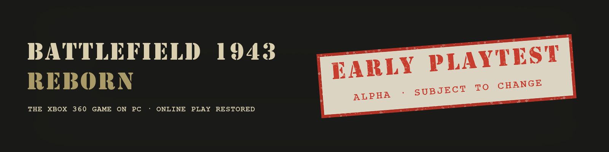

<div align="center">



### Battlefield 1943 on PC, running natively, with its online multiplayer back on servers anyone can run.

**Alpha playtest.** The 2009 Xbox 360 game by DICE, for Windows and Linux: all four maps, 24 players a server,
Reborn servers and community servers, and the options of a modern PC release.

[](https://github.com/TekRantGaming/Battlefield-1943-Reborn/releases/latest)
&nbsp;
[](https://github.com/TekRantGaming/Battlefield-1943-Reborn/releases/latest)
&nbsp;
[](https://discord.gg/8eakYSvBZS)

[](https://github.com/TekRantGaming/Battlefield-1943-Reborn/releases/latest)
[](https://github.com/TekRantGaming/Battlefield-1943-Reborn/releases)


<a href="https://recomplauncher.com/game/battlefield-1943-reborn"><picture><source media="(prefers-color-scheme: dark)" srcset="https://recomplauncher.com/assets/press/launcher/badge-light.svg"></picture></a>

<br><br>


<sub>The original Xbox 360 game code, translated to native PC code with the <a href="https://github.com/rexglue/rexglue-sdk">ReXGlue SDK</a> and drawn with Vulkan. <b>No game files included</b>: bring your own copy of the Xbox 360 game. A fan project, not made, endorsed or supported by Electronic Arts or DICE.</sub>

</div>

<br>

> [!WARNING]
> **Alpha playtest.** Battlefield 1943 Reborn is in early playtesting. Expect bugs, crashes and big changes between
> builds, and stats that reset. Tell us what you find on our [Discord](https://discord.gg/8eakYSvBZS).

## At a glance

| | | |
| :--- | :--- | :--- |
| 🌴 **All four maps**: Wake Island, Guadalcanal, Iwo Jima and Coral Sea | 🌐 **Online play is back**, with Reborn servers and anyone's own | ⏱️ **60 Hz servers**, twice the console's tick rate |
| 🖥️ **Your screen's resolution and refresh rate**, ultrawide too | 🎞️ **Any frame rate**: a limit from 30 to 240, or none | 🎨 **Ambient occlusion, global illumination** and grass to the horizon |
| 🖱️ **Keyboard and mouse** in every seat, planes flown with the mouse | 🎮 **Any controller**, with Xbox, PlayStation or Steam Deck prompts | 🎚️ **Graphics presets** from Potato to Ultra |
| 🎙️ **Proximity voice chat** and text chat, with a profanity filter | 🔒 **Custom Match**: your own match, online or LAN, with a password | 🔎 **Server browser** with regions, tick rates and Direct connect |
| 🗺️ **Lettered flags** and a map of the whole battle in the menu | 🔄 **Updates itself** at every start | 🚂 **Add to Steam** with the game's artwork |
| 🏅 **Stats & Awards, Leaderboards** and **Achievements**, all 12 plus 3 of Reborn's own | 🏷️ **Clan tags** and **a name you can protect**, with no email or password | ⚖️ **Fairer teams**, with no points lost when you are moved |
| 🐧 **Linux and Steam Deck** as one AppImage, Ubuntu 22.04 and newer | 🖧 **Host your own servers** from a page in your browser | 📰 **News** on the main menu and **your match on Discord** |
| 🐞 **Report an issue** from the game, no GitHub account needed | 🔊 **The original menu sounds** in our menus | 💬 **[Join the Discord](https://discord.gg/8eakYSvBZS)** right from Home |

## The battlefield

All four maps of the original: **Wake Island**, **Guadalcanal**, **Iwo Jima** and **Coral Sea** (Air Superiority).
Up to 24 players a server, on foot, in jeeps, tanks, boats and planes, with the air raid, as in the original.

## Modern graphics

The game's Xbox 360 graphics drawn with Vulkan at your screen's resolution, with what the console never had:

- **Ambient occlusion** (Intel's XeGTAO) and **global illumination**: shade where light cannot reach, and light bounced
  between surfaces
- **Grass and shrubs** on Wake Island, Guadalcanal and Iwo Jima, placed from each level's own data and drawn to the horizon
- **Sharper shadows**, up to four times the original
- **Graphics presets** from Potato to Ultra, and AMD FSR 1 or NVIDIA Image Scaling for older and low end PCs

## Online play

EA's servers for Battlefield 1943 are gone. Reborn brings online play back with its own main backend, which every
player logs in to and which lists every server.

<table>
<tr>
<td width="55%"></td>
<td valign="middle">

### Server browser
- Tabs: **Reborn**, **Community**, **Favorites**, **LAN** and **Direct Connect**
- Each server's **map**, **players**, **region** with its flag, **tick rate** and **ping**
- **Search**, a **region filter**, Has players, Not full, and sorting
- **Quick Play** on Home joins the busiest server with room

</td>
</tr>
<tr>
<td valign="middle">

### Reborn servers and community servers
- **Reborn servers** are run by TekRantGaming at 60 Hz: in **EU Central**, All Maps with Wake Island, Guadalcanal and
  Iwo Jima in turn, and **Air Superiority** on Coral Sea; in **US Central**, a server testing a new server build
- **Community servers**: anyone can host dedicated servers with `BF1943-Reborn-Server-<version>-windows.zip`, managed
  from a page in the browser, each with its own name, description, maps, players, region and tick rate. See
  [docs/SERVER.md](docs/SERVER.md)
- **Custom Match**: a match on your own PC for you and your friends, online or LAN, with a password if you want one
- **Fairer teams** on Reborn servers: lopsided teams are evened out one player at a time, with no points lost
- Messages from a server to everyone on it, for an update or a restart, and a clear message when a server is full or
  the servers are closed for maintenance

</td>
<td width="55%"></td>
</tr>
</table>

## Your progress and your name

- **Stats & Awards**: your rank, kills, flags, headshots, repairs, your time in each kit and vehicle and your results
  on each map, counted by the Reborn servers, for all time, this month and this week
- **Leaderboards**: Score, Kills, K/D, Flags and Time, with your own row pinned
- **Achievements**: the game's 12 plus 3 of Reborn's own, with your progress on each, how many players have it, and a
  popup with a chime when you unlock one
- **Clan tags**: 2 to 4 letters or digits before your name, as [TAG]YourName, on the menus, the scoreboard, the kill
  feed and in chat
- **Protect your name** with a recovery code, no email or password: your name, rank and stats come back on a new PC
  with the code, and anyone else using your name plays with a number added

## Getting started

**You need:** Windows 10 or 11 (64 bit), or Linux on x86_64 (glibc 2.35 or newer: Ubuntu 22.04, Linux Mint 21 and
newer, X11 or XWayland), a graphics card with Vulkan (NVIDIA GTX 10 series, AMD RX 5000 series, Intel Arc or newer
recommended), a processor with SSE4.2 (Intel Core i3, i5, i7 or AMD FX, Ryzen and newer), 8 GB of memory, and your
own copy of Battlefield 1943 for Xbox 360 (Xbox Live Arcade, title ID `5841097E`): its package file from your console.
The full list: [docs/SYSTEM-REQUIREMENTS.md](docs/SYSTEM-REQUIREMENTS.md).

1. Download **BF1943-Reborn-...-windows-x64.zip** from the [latest release](https://github.com/TekRantGaming/Battlefield-1943-Reborn/releases/latest)
   and unzip it somewhere you can write to (for example `C:\Games`, not Program Files).
2. Run **bf1943.exe**.
3. The first time, a short setup: select your Battlefield 1943 package (the single file in `5841097E\000D0000` from your
   console's storage, or a folder that holds it; it is installed into the folder `game`, once). The game then prepares
   its shaders, once, so effects do not stutter the first time you see them. Then choose your soldier name and clan
   tag (and protect your name if you like), your display, graphics, controls and voice chat.
4. **Quick Play** joins the busiest server with room, or pick one in the **Server Browser**.

Your settings, logs and crash reports stay in the folder `user` next to the game.

If Windows says *"rexruntime.dll is either not designed to run on Windows or it contains an error"* (Bad Image,
0xc0e90002), it is not a broken download: the builds are not code signed yet, and Windows 11's Smart App Control has
not cleared this build's files.

### Linux

1. Download **BF1943-Reborn-linux-x86_64.AppImage** from the [latest release](https://github.com/TekRantGaming/Battlefield-1943-Reborn/releases/latest)
   into a folder of its own (for example `~/Games/BF1943-Reborn`): its `game` and `user` folders go beside it.
2. Make it runnable (right click it, **Properties**, **Allow executing file as program**, or `chmod +x`) and run it.
3. Everything else works as on Windows. It needs `curl` for updates; tested on a ROG Ally with Bazzite. Videos in the
   news window open on YouTube in your browser.

### Updates

**The game updates itself.** At every start it looks at this page's latest release; a newer one is downloaded, checked
against the release's `SHA256SUMS.txt`, installed and started. On Windows only the files that changed are replaced, and
if any of them cannot be, every one is put back; on Linux the AppImage replaces itself. Your `game` and `user` folders
are never touched, and the shaders are prepared once more for the new version. The servers only let the newest version
in: when a newer one is out, a pop-up says so, with **Update**. Builds before 0.2.0 cannot update themselves: download the latest once and unzip it over your folder.

## Settings

Everything is in our Settings menu, from the main menu and the pause menu, with a controller, the keyboard or the mouse.

<table>
<tr>
<td width="55%"></td>
<td valign="middle">

### Graphics
- **Presets**: Potato, Low, Medium, High and Ultra, for integrated graphics up to fast cards
- **Antialiasing**: FXAA, SMAA and Intel CMAA 2
- **Upscaling**: AMD FSR 1 or NVIDIA Image Scaling, with sharpening (AMD CAS)
- **Shadows** up to four times the original, **texture filtering** up to 16x
- **Ambient occlusion** (Intel's XeGTAO) and **global illumination**, with quality settings
- **Grass and shrubs**, placed from each level's own data, drawn as far as the whole map
- **Motion blur** (Off, Low, Medium, High), animation smoothing, HD textures

</td>
</tr>
<tr>
<td valign="middle">

### Display
- **Windowed or borderless**, the monitor, window size, resolution and **refresh rate**
- **Frame rate limit** from 30 to 240, or none, and **VSync**; **Future frame rendering** for more frames (off by default)
- **Ultrawide**: the game fills 21:9, 32:9 and other wide screens with a wider view, the HUD at the screen's sides or in
  the middle; or Letterbox 16:9
- **Field of view** on foot and in vehicles, camera shake, brightness and gamma, HUD scale and minimap size

</td>
<td width="55%"></td>
</tr>
<tr>
<td></td>
<td valign="middle">

### Controls
- **By device**: pick **Keyboard & Mouse** or **Controller** and see only its own settings and bindings, with a picture
  of your device and the chosen key or button lit up
- **Keyboard and mouse** beside any controller, every key rebindable, two keys and two mouse buttons for each action
- The **mouse aims** guns and turrets in every seat, **flies planes**, and looks around from a driver's or passenger's seat
- Mouse sensitivity, with its own for aiming down sights and for vehicles; aim hold or toggle; **Iron Sight** for the SMGs
- **Controllers** play as on the console, with the game's own layouts (Normal, Southpaw, Lefty), sensitivity, dead zone,
  inversion, vibration and remapping
- **Button prompts** for Xbox Series, PlayStation 3, PlayStation 5, Steam Deck or the keys, from Kenney's Input
  Prompts, or the game's own Xbox 360 style, changing as you switch between controller and keyboard

</td>
</tr>
<tr>
<td valign="middle">

### Audio, Gameplay and Enhancements
- **Volume** for master, music, effects and voices, menu music and sounds, the game's voiceover language
- **The original menu sounds** in our menus, and **achievement popups** with their chime, each with its own volume
- **Voice chat**: push to talk, open mic or off, voice volume and microphone sensitivity
- **The game in** English, French, German, Italian, Spanish or Japanese, aim assist, text chat, performance metrics,
  **Discord status**
- **Enhancements**: what Reborn adds to the game, such as the lettered flags

</td>
<td width="55%"></td>
</tr>
</table>

## Controls

Keyboard and mouse are on by default, beside any controller. Every key can be changed in Settings > Controls >
Keyboard & Mouse.

| Key | On foot | In a vehicle |
|---|---|---|
| <kbd>W</kbd> <kbd>A</kbd> <kbd>S</kbd> <kbd>D</kbd> | move | W throttle, S brake, A D turn |
| Mouse | look and aim | aim the guns and turret; look around from a driver's or passenger's seat; fly a plane |
| Left mouse button | fire | fire |
| Right mouse button | aim down sights | second weapon (bombs in a plane) |
| <kbd>Space</kbd> | jump | change seat |
| <kbd>E</kbd> | enter a vehicle, use, pick up | get out |
| <kbd>R</kbd> | reload | |
| <kbd>F</kbd> | draw knife (the Infantry class's wrench) | |
| <kbd>G</kbd> | grenade, explosives | free look in a plane |
| <kbd>Q</kbd> or the mouse wheel | switch weapon | second weapon (bombs in a plane) |
| <kbd>Shift</kbd> | sprint | |
| <kbd>C</kbd> or <kbd>Ctrl</kbd> | crouch | |
| <kbd>V</kbd> or <kbd>Up</kbd> | | vehicle camera (the bomb sight in the air raid) |
| <kbd>Tab</kbd> | command (tap), score (hold) | the same |
| <kbd>T</kbd>, <kbd>Y</kbd>, <kbd>U</kbd> | chat to everyone, your team, your squad | the same |
| <kbd>B</kbd> | push to talk (hold) | the same |
| <kbd>Esc</kbd> or <kbd>Enter</kbd> | the menu | the menu |
| <kbd>F2</kbd> | performance metrics | the same |

Planes: the mouse moves the stick. Left and right roll, forward and back pitch, and the stick springs back to the
centre when the mouse stops; W is the throttle, S the brake, A and D the rudder. On a controller planes fly as on the
Xbox 360: left trigger throttle, right stick pitch and roll, left stick rudder, right bumper bombs, left bumper free look.

## Good to know

### Known issues

This is an alpha. The main ones:

- The first person weapon and hands move with the game's own updates, not every frame, at high frame rates (the view
  itself turns on every frame).
- Stats, awards and leaderboards count only on Reborn servers, and as this is an alpha they may still be reset.
- No HDR. On 16:10 and 4:3 screens Fill screen crops the picture's sides: Settings > Display > Aspect ratio >
  Letterbox 16:9 shows all of it.
- Linux: the Vulkan renderer needs X11 or XWayland; the game's tutorial (Help) can drop back to the menu at once; the
  server download is for Windows only for now.
- Voice chat has no echo cancelling: with Open mic, use headphones. Push to talk and the chat keys are keyboard keys:
  with a controller only (Steam Deck, ROG Ally), use Open mic, or map a back button to B in Steam Input.
- Overlays hooked into the game (OBS, Overwolf, RivaTuner and the like) can get in the way of its display: if the game
  misbehaves, try without them.
- The builds are not code signed yet (see [Getting started](#getting-started)).
- HD textures can be imported (Settings > Graphics), but no texture pack has been published.

### Reporting a problem

Use **Report an issue** on the main menu: say what happened, tick what goes with it (your PC and settings, the end of
the log, a crash report, a screenshot), and send it from the game with no GitHub account, open it on GitHub with your
own, or copy it. A report that could not be sent is tried again at the next start. Or open an
[issue](https://github.com/TekRantGaming/Battlefield-1943-Reborn/issues) yourself with what you did, what you saw and
what you expected, your CPU and graphics card, and the files from `user\crashes` for a crash.

### Privacy

- **Share graphics data** (on by default, Settings > Gameplay > Sharing) sends the graphics pipelines your game builds
  (render settings and shader numbers: no game files, no name, nothing about you) to our server, at most every 15
  minutes and only when something new was built, so the next update has them ready and everyone gets less stutter.
- Playing online, the backend sees the name you chose and your IP address, as any game server does. Your stats are
  kept under your soldier name.
- **Protect your name** needs no email or password, and your recovery code never leaves your PC: the game only proves
  it has the code. Keep a copy somewhere safe, as nobody else can give it back to you.
- **Report an issue** sends only what you ticked, and you see all of it first. Your user name, PC name, addresses,
  recovery code and email addresses are taken out before anything is sent.
- **Discord status** talks only to the Discord app on your own PC, and shows what you are playing, never a server
  address or another player's name. Turn it off in Settings > Gameplay.
- **The news window** reads our news from this repository on GitHub; its videos are YouTube's own player.
- **Voice and text chat** go through the server you play on: your voice only to the players near you, and only while
  you hold push to talk (or speak, with Open mic); the game opens your microphone only when you first use it. Servers
  keep a log of text chat for moderation; voice is passed on, never recorded.
- The game's own Telemetry setting changes nothing: its reports went to EA's servers, which are gone.
- Settings, logs and crash reports stay on your PC, in the folder `user`.

## How it works

- **Static recompilation.** The Xbox 360 program is translated ahead of time into native 64 bit code for Windows and
  Linux with the ReXGlue SDK (derived from the Xenia emulator), and runs on its runtime (`rexruntime.dll`, on Linux
  `librexruntime.so`), which stands in for the console's system services. The game's own code runs natively; it is
  not emulated.
- **NativeXRenderer.** The game's Xbox 360 graphics work is drawn with Vulkan by NativeXRenderer
  (`rexgpu-bfnative.dll`), with this project's additions: ambient occlusion, global illumination, grass, sharper
  shadows and motion between the game's updates.
- **Online.** The game talked to EA's servers and Xbox LIVE. Reborn answers it with its own backend
  (`server\plasma.py`: login, server list, stats), and each dedicated server has a host (`server\gmhost.py`) that links
  players to it. A dedicated server is the game itself, run as a server with no window.
- **Our menus.** The first start setup, main menu, server browser, pause menu and settings are this project's own,
  drawn over the game, which keeps its own HUD.

<details>
<summary><b>Source code and building (for developers)</b></summary>

This repository holds the source code, next to the releases, the changelog and the guides. It contains no game files
and none of the game's code: the code generator translates the game's program on your PC, from your own copy.
Pull requests go to the **in-dev** branch; **main** holds the released code.

| Folder | What it holds |
|---|---|
| `bf` | The port itself: our menus and launcher, online services, the server mode, the renderer's game profile, and NativeXRenderer with our changes |
| `sdk/src-bf` | Our copy of the ReXGlue SDK, with its third party libraries |
| `server` | The backend and the dedicated server's host (Python) |
| `tools` | Packaging, the server package's scripts, the Linux build, and the helpers used to study the game |
| `docs` | The players' guides and the technical notes |

You need Visual Studio 2022 Build Tools with clang, CMake and Ninja, Git, Python 3.12, and your own Battlefield 1943
package.

```bat
git config --global core.longpaths true
git clone --recursive https://github.com/TekRantGaming/Battlefield-1943-Reborn.git
cd Battlefield-1943-Reborn
sdk\src-bf\build_bf.bat
python -I tools\stfs_extract.py "<your package file>" input\pkg
mklink /J bf\assets input\pkg
cd bf
..\sdk\src-bf\out\install\win-amd64\bin\rexglue.exe codegen bf1943_manifest.toml
build.bat bf-relwithdebinfo
```

The game is in `bf\out\build\bf-relwithdebinfo`. Linux builds run in WSL with the scripts in `tools/linux`. All the
steps: [BUILDING.md](BUILDING.md). Third party code and its licences: [THIRD_PARTY_NOTICES.md](THIRD_PARTY_NOTICES.md).

</details>

## Credits

- **Battlefield 1943** by DICE, published by Electronic Arts in 2009.
- **Battlefield 1943 Reborn** by TekRantGaming and contributors (MIT, [LICENSE](LICENSE)): the port's own code.
- **[@ThatZaliaSGuy](https://github.com/ThatZaliaSGuy)**: ultrawide screens, mouse flying, free look in vehicles and
  the mouse in the game's own input ([pull request 11](../../pull/11)); the mouse in every vehicle seat, Custom Match
  with LAN, key bindings with two keys, HUD scale and minimap size, and the experimental tick rates
  ([pull request 16](../../pull/16)); Custom Match passwords, Iron Sight, motion blur and menu work
  ([pull request 20](../../pull/20)); the server stall diagnostics ([pull request 22](../../pull/22)).
- **[@DiXN](https://github.com/DiXN)**: the big performance work, the renderer's own drawing thread, Future frame
  rendering, the audio crackling fix, the leaner Linux build and Wayland ([pull request 28](../../pull/28)).
- **[@Erubadhron](https://github.com/Erubadhron)**: deploy map clicks that land where you click
  ([pull request 31](../../pull/31)).
- **[@DicksonWu654](https://github.com/DicksonWu654)** (Dickson Wu, from SEAL & CertiK): reported an issue to us
  privately, fixed in 0.4.7.5.
- [**ReXGlue SDK**](https://github.com/rexglue/rexglue-sdk) (BSD 3 Clause), derived from
  [**Xenia**](https://github.com/xenia-project/xenia): the recompiler and runtime.
- **NativeXRenderer** by Gustavo Garcia (MIT): the Vulkan renderer. **GHMetalRecomp** (MIT): its NativeXRenderer
  profile, which Battlefield's started from.
- [**King Kong Recompiled**](https://github.com/TekRantGaming/king-kong-recompiled) by TekRantGaming and contributors
  (MIT): the ambient occlusion, global illumination and camera work, and much of what we learned.
- **DiligentCore** (Apache 2.0), **SPIRV Cross** (Apache 2.0), **volk** (MIT): the renderer's foundations.
- **XeGTAO** by Intel (MIT), **AMD FidelityFX** (MIT), **NVIDIA Image Scaling** (MIT), **SMAA** (MIT style) and
  **NVIDIA DLSS** (NVIDIA RTX SDKs licence): libraries the renderer is built with.
- **FFmpeg** (its decoders only) and **libmspack**, both LGPL 2.1, in the runtime. **vgmstream** (ISC): the layout of
  the game's menu music. **Oswald** (SIL Open Font Licence): the menus' font.
- Button prompts: **Input Prompts** by [Kenney](https://kenney.nl/assets/input-prompts) (CC0); our controller
  drawings in Settings > Controls follow its outlines. The Discord and Steam marks from **Simple Icons** (CC0).
- Add to Steam's artwork and More from TRG Studios' pictures from [**SteamGridDB**](https://www.steamgriddb.com),
  downloaded when used.

Every download includes the full licence texts in its `licences` folder.

> [!NOTE]
> **AI disclosure:** this port was made almost entirely with Claude Code (Anthropic). The repository owner directed
> and tested the work; the AI did the analysis, code, tools and documentation.

> [!IMPORTANT]
> Battlefield and Battlefield 1943 are trademarks of Electronic Arts Inc. All rights to the game belong to their owners.
> This project is not affiliated with or endorsed by Electronic Arts, DICE, Microsoft, Valve or Discord. It contains no
> game files or game assets: everyone installs their own copy. Please do not share game files, and do not open issues
> asking for them.
