<div align="center">

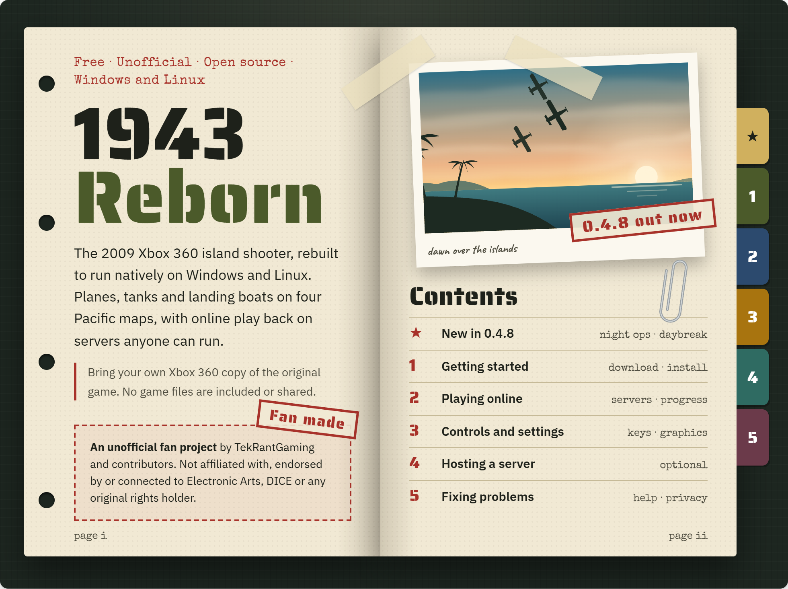

[](https://github.com/TekRantGaming/Battlefield-1943-Reborn/releases/latest)
&nbsp;
[](https://github.com/TekRantGaming/Battlefield-1943-Reborn/releases/latest)
&nbsp;
[](https://bf1943.tekrantgaming.com)
&nbsp;
[](https://discord.gg/8eakYSvBZS)

[](https://github.com/TekRantGaming/Battlefield-1943-Reborn/releases/latest)
[](https://github.com/TekRantGaming/Battlefield-1943-Reborn/releases)


[](LICENSE)


<a href="https://recomplauncher.com/game/battlefield-1943-reborn"><picture><source media="(prefers-color-scheme: dark)" srcset="https://recomplauncher.com/assets/press/launcher/badge-light.svg"></picture></a>

**[Get started](#getting-started)** &nbsp;·&nbsp; **[What's new](#new-in-048)** &nbsp;·&nbsp; **[Play online](#playing-online)** &nbsp;·&nbsp; **[Settings](#controls-and-settings)** &nbsp;·&nbsp; **[Host a server](#hosting-a-server)** &nbsp;·&nbsp; **[Help](#fixing-problems)** &nbsp;·&nbsp; **[Credits](#for-the-record)**

</div>

<br>

**1943 Reborn** brings the 2009 Xbox 360 island shooter to PC: the original game's code, rebuilt to run natively on
Windows and Linux, with planes, tanks and landing boats on four Pacific maps and online play back on servers anyone can
run. It is **free, unofficial and open source**, and it ships **no game files**: you bring your own Xbox 360 copy.

> [!WARNING]
> **Alpha playtest.** 1943 Reborn is still being tested. Expect bugs, crashes and big changes between builds. Tell us
> what you find on our [Discord](https://discord.gg/8eakYSvBZS) or with **Report an issue** in the game.

<table>
<tr>
<td width="33%" valign="top"><br><b>All four maps</b><br>Wake Island, Guadalcanal, Iwo Jima and Coral Sea, with the air raid, as in the original.</td>
<td width="33%" valign="top"><br><b>Online play is back</b><br>Reborn servers and anyone's own, at 60 Hz, twice the console's tick rate, for up to 64 players.</td>
<td width="33%" valign="top"><br><b>Night Ops and Daybreak</b><br>Night battles under a building storm, and rounds that start at sunrise in the mist. New in 0.4.8.</td>
</tr>
<tr>
<td valign="top"><br><b>A modern PC release</b><br>Your resolution and refresh rate, ultrawide, any frame rate, ambient occlusion, global illumination and grass to the horizon.</td>
<td valign="top"><br><b>Keyboard, mouse or controller</b><br>The mouse in every seat and on the stick of every plane, any controller, with Xbox, PlayStation or Steam Deck prompts.</td>
<td valign="top"><br><b>Your progress</b><br>Stats, leaderboards, all 12 achievements plus 8 of our own, clan tags, and a name you can protect.</td>
</tr>
<tr>
<td valign="top"><br><b>Bots and Custom Match</b><br>Bots that fill the empty slots, and your own match with your own rules, time of day and weather.</td>
<td valign="top"><br><b>Host your own servers</b><br>Free, on Windows or Linux, run from a page in your browser, with bans, a dashboard and bots.</td>
<td valign="top"><br><b>Updates itself</b><br>At every start, checked against the release's checksums. Add it to Steam with one click.</td>
</tr>
</table>

<a name="new-in-048"></a>

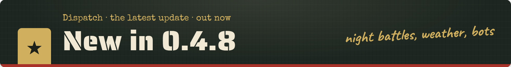

**0.4.8 is the biggest update to 1943 Reborn yet**, released on **27 November 2026**: night battles, battles from
sunrise, weather, bigger servers with bots, a new Custom Match and tools for the people who run servers. Your game
updates itself to it at its next start, and server managers with Automatic updates on update by themselves.

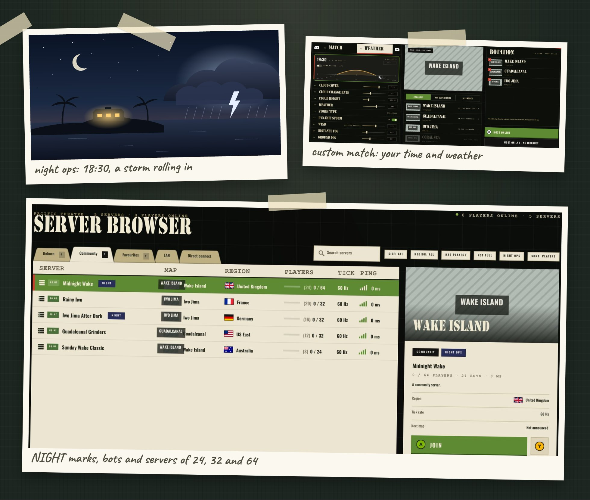

<table>
<tr>
<td width="50%" valign="top">


### Night Ops
A new kind of server for night battles. The world is held at dusk, at 18:30; lamps, headlights and the insides of
buildings are lit; and a storm builds as the tickets fall, from a clear night under the stars to a full storm for the
final push. Find them with the **Night ops** filter in the Server Browser.

</td>
<td width="50%" valign="top">


### Daybreak
A new kind of server for battles from sunrise. The round starts at dawn, at 06:10, with mist and ground fog, and a
thunderstorm builds as the tickets fall. Look for the **Daybreak** server on the Reborn tab.

</td>
</tr>
</table>

| | | |
| :--- | :--- | :--- |
| <br>**Weather and sky**<br>A day and night cycle, clouds you can fly through, rain, thunderstorms, a hurricane with a calm eye, fog and ground fog, and guns and vehicles that get wet. Chosen by each Night Ops or Daybreak server or Custom Match. | <br>**Bigger servers**<br>24 players (the original), 32 (the new default) or up to 64. Tickets scale with the size, so rounds last as long as they should. | <br>**Bots**<br>The host's choice: bots fill the empty slots and give way when you join. They take flags, drive tanks and land on the beaches, show as BOT and stay out of your stats. |
| <br>**A new Custom Match**<br>A page of its own with Match and Weather tabs: game mode, map rotation, tickets, match time, bots, the time of day and the storm. | <br>**The electric skin**<br>Your first unlockable: a storm in your Thompson or Type 100, earned by playing one full Night Ops match. | <br>**Planes on keys and mouse**<br>Yaw, pitch and roll on any keys, mouse buttons or the mouse, and bindings of their own for each kind of vehicle. |
| <br>**Your sound devices**<br>Game sound, chat output and chat input, each on its own device: the game on speakers, the voices in your headset. | <br>**Ping on the scoreboard**<br>Every player's ping, and a warning before you join a server more than 90 ms away. | <br>**A clearer name page**<br>Your tag beside your name, your name protected for you, your recovery code on a card of its own. |
| <br>**Sharper menus**<br>Menu text stays sharp with Windows display scaling, on laptops and 4K screens. | <br>**A stormy news window**<br>Rain, lightning and the weather's sounds, fading out as you read. | 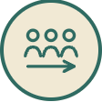<br>**Fairer queues**<br>Players who share an address, a family or a LAN party, each keep their own place in a queue. |

**For the people who run servers:** your own **ban list, kicks and mutes** with a player lookup and a log, a
**dashboard** of your servers live and over 90 days with an optional **community page**, **players, bots and tickets**
on each server's page, and **F9 for admins** in the match for the time, the weather and a free camera.

> [!NOTE]
> **What stays the same.** Regular servers play as the released game did, in daylight with its own look: night,
> weather and bots appear only where a server or a Custom Match chooses them. Your own servers, Custom Match on LAN and
> Direct Connect keep working without the main backend. Every change is in the [CHANGELOG](CHANGELOG.md) and on the
> website's [every change in 0.4.8](https://bf1943.tekrantgaming.com/updates/0-4-8) page.

<a name="getting-started"></a>

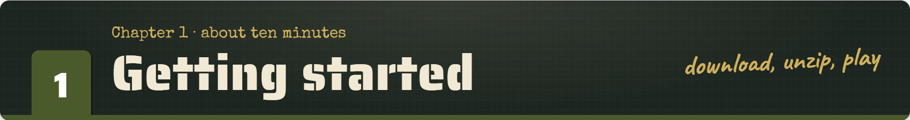

### Download

<table>
<tr>
<td width="33%" valign="top">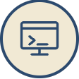<br><b>Windows</b><br>Windows 10 or 11, 64 bit.<br><code>BF1943-Reborn-&lt;version&gt;-windows-x64.zip</code><br><br><a href="https://github.com/TekRantGaming/Battlefield-1943-Reborn/releases/latest"><b>Download for Windows</b></a></td>
<td width="33%" valign="top"><br><b>Linux and Steam Deck</b><br>x86_64, glibc 2.35 or newer.<br><code>BF1943-Reborn-linux-x86_64.AppImage</code><br><br><a href="https://github.com/TekRantGaming/Battlefield-1943-Reborn/releases/latest"><b>Download for Linux</b></a></td>
<td width="33%" valign="top"><br><b>Server package</b><br>Optional, for hosts only. Windows or Linux.<br><code>BF1943-Reborn-Server-&lt;version&gt;-windows.zip</code>, <code>-linux.tar.gz</code> or the server AppImage<br><a href="#hosting-a-server"><b>About hosting</b></a></td>
</tr>
</table>

> [!IMPORTANT]
> **You need your own copy of the game.** 1943 Reborn runs on the files from your own Xbox 360 copy of the original
> game, Battlefield 1943 (Xbox Live Arcade, title ID `5841097E`). No game files are included, and we cannot help you
> get them. The PlayStation 3 version does not work.

### System requirements

| | Windows | Linux |
| :--- | :--- | :--- |
| **System** | Windows 10 or 11, 64 bit | x86_64 with glibc 2.35 or newer: Ubuntu 22.04, Linux Mint 21, Debian 12, SteamOS, Bazzite and newer |
| **Processor** | With SSE4.2: Intel Core i3, i5, i7, AMD FX, Ryzen or newer | the same |
| **Memory** | 8 GB | 8 GB |
| **Graphics** | Vulkan. NVIDIA GTX 10 series, AMD RX 5000 series, Intel Arc or newer recommended | Vulkan: Mesa's RADV or NVIDIA's driver |
| **Online** | An internet connection to play online | the same, and `curl` for updates |

The measurements behind them: [docs/SYSTEM-REQUIREMENTS.md](docs/SYSTEM-REQUIREMENTS.md).

### Install on Windows

1. Download **BF1943-Reborn-...-windows-x64.zip** from the [latest release](https://github.com/TekRantGaming/Battlefield-1943-Reborn/releases/latest)
   and unzip it somewhere you can write to (for example `C:\Games`, not Program Files).
2. Run **bf1943.exe**.
3. The first time, a short setup: select your game package (the single file in `5841097E\000D0000` from your console's
   storage, or a folder that holds it; it is installed into the folder `game`, once). The game then prepares its
   shaders, once, so effects do not stutter the first time you see them. Then choose your soldier name and clan tag
   (your name is protected for you), your display, graphics, controls and voice chat.
4. **Quick Play** joins the busiest server with room, or pick one in the **Server Browser**.

Your settings, logs and crash reports stay in the folder `user` next to the game.

If Windows says *"rexruntime.dll is either not designed to run on Windows or it contains an error"* (Bad Image,
0xc0e90002), it is not a broken download: the builds are not code signed yet, and Windows 11's Smart App Control has
not cleared this build's files.

### Install on Linux, Steam Deck and handhelds

1. Download **BF1943-Reborn-linux-x86_64.AppImage** from the [latest release](https://github.com/TekRantGaming/Battlefield-1943-Reborn/releases/latest)
   into a folder of its own (for example `~/Games/1943-Reborn`): its `game` and `user` folders are made beside it.
2. Make it runnable (right click it, **Properties**, **Allow executing file as program**, or `chmod +x`) and run it.
3. The first start is the same as on Windows. On a Steam Deck or in Big Picture, **Add to Steam** on the launcher's
   Home adds it to your library with its artwork, and the shortcut keeps working after updates.

The game uses Wayland where it is available, and X11 or XWayland elsewhere. Videos in the news window open on YouTube
in your browser.

### Updates

**The game updates itself.** At every start it looks at this page's latest release; a newer one is downloaded, checked
against the release's `SHA256SUMS.txt`, installed and started. On Windows only the files that changed are replaced, and
if any of them cannot be, every one is put back; on Linux the AppImage replaces itself. Your `game` and `user` folders
are never touched, and the shaders are prepared once more for the new version. The servers only let the newest version
in: when a newer one is out, a pop-up says so, with **Update**.

<p align="center">
<a href="https://bf1943.tekrantgaming.com/guides/install-windows">Install on Windows</a> &nbsp;·&nbsp;
<a href="https://bf1943.tekrantgaming.com/guides/install-linux">Linux and handhelds</a> &nbsp;·&nbsp;
<a href="https://bf1943.tekrantgaming.com/guides/game-files">Your game files</a> &nbsp;·&nbsp;
<a href="https://bf1943.tekrantgaming.com/guides/first-start">The first start</a> &nbsp;·&nbsp;
<a href="https://bf1943.tekrantgaming.com/guides/add-to-steam">Add to Steam</a><br>
<sub>Step by step guides with pictures, in the field manual on our website.</sub>
</p>

<a name="playing-online"></a>

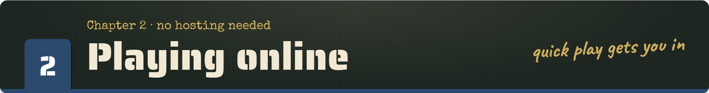

EA's servers for the original game are gone. 1943 Reborn brings online play back with its own main backend, which every
player logs in to and which lists every server. **You never need to host**: the Reborn servers and the
community's servers are online around the clock.

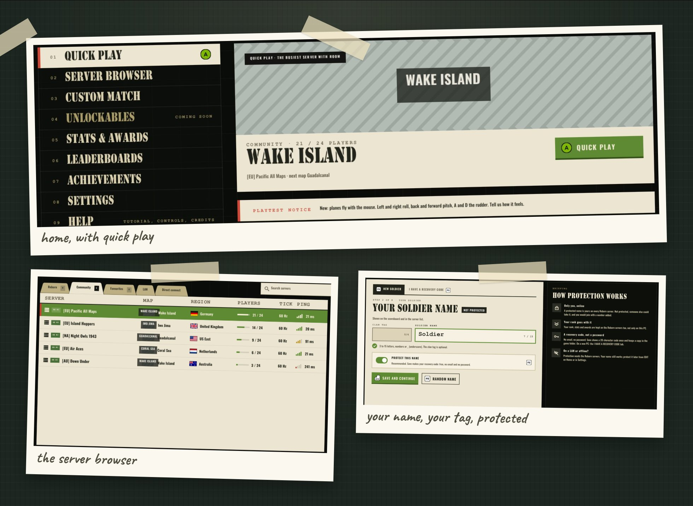

<table>
<tr>
<td width="50%" valign="top">

### Join a game
- **Quick Play** on Home joins the busiest server with room
- **The Server Browser**: tabs for **Reborn**, **Community**, **Favourites**, **LAN** and **Direct Connect**; each
  server's map, players and bots, region and flag, tick rate and ping; search, filters (size, region, has players, not
  full, Night ops) and sorting
- **Queues** when a server is full, with a place of your own
- **Fairer teams**: lopsided teams are evened out one player at a time, with no points lost

</td>
<td width="50%" valign="top">

### Reborn servers
Run by TekRantGaming at 60 Hz in Europe (EU Central), all with bots, on Wake Island, Guadalcanal and Iwo Jima:

| Server | Players |
| :--- | :---: |
| **1943 Reborn: Classic** | 24 |
| **1943 Reborn: Night Ops** | 32 |
| **1943 Reborn: Daybreak** | 32 |

Community servers sit beside them under **Community**.

</td>
</tr>
</table>

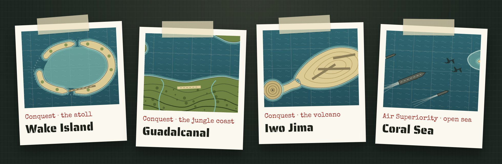

### Play with friends
**Custom Match** hosts a match on your own PC while you play in it, online through the main backend or on your LAN,
with an optional password: game mode, an ordered map rotation, tickets, match time, bots, the time of day and the
weather. The host gets **F9** for the time and weather while the match runs. In detail:
[docs/BOTS-AND-CUSTOM-MATCH.md](docs/BOTS-AND-CUSTOM-MATCH.md).

### Your name and progress
- **Stats & Awards**: your rank, kills, flags, headshots, repairs, your time in each kit and vehicle and your results
  on each map, counted by the Reborn servers, for all time, this month and this week
- **Leaderboards**: Score, Kills, K/D, Flags and Time, with your own row pinned
- **Achievements**: the game's 12 plus 8 of Reborn's own, with your progress on each, how many players have it, and a
  popup with a chime when you unlock one
- **Unlockables**: the electric weapon skin, from one full Night Ops match
- **Clan tags**: 2 to 4 letters or digits before your name, as `[TAG]YourName`, on the menus, the scoreboard, the kill
  feed and in chat
- **Protect your name** with a recovery code, no email or password: your name, rank and stats come back on a new PC
  with the code, and anyone else using your name plays with a number added

### Talk and keep up
- **Proximity voice chat** (push to talk or open mic) and **text chat** to everyone, your team or your squad, with a
  profanity filter
- **News** on the main menu, **your match on your Discord profile**, and messages from a server's owner for an update
  or a restart

<p align="center">
<a href="https://bf1943.tekrantgaming.com/guides/join-a-game">Joining a game</a> &nbsp;·&nbsp;
<a href="https://bf1943.tekrantgaming.com/guides/custom-match">Custom Match</a> &nbsp;·&nbsp;
<a href="https://bf1943.tekrantgaming.com/guides/night-ops">Night Ops</a> &nbsp;·&nbsp;
<a href="https://bf1943.tekrantgaming.com/guides/weather">Weather, sky and night</a> &nbsp;·&nbsp;
<a href="https://bf1943.tekrantgaming.com/guides/servers-and-bots">Bigger servers and bots</a> &nbsp;·&nbsp;
<a href="https://bf1943.tekrantgaming.com/guides/stats">Stats</a> &nbsp;·&nbsp;
<a href="https://bf1943.tekrantgaming.com/guides/protect-your-name">Protect your name</a> &nbsp;·&nbsp;
<a href="https://bf1943.tekrantgaming.com/servers">Every server, live</a>
</p>

<a name="controls-and-settings"></a>

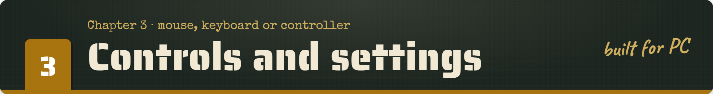

Everything is in our own Settings menu, from the main menu and the pause menu, with a controller, the keyboard or the
mouse.

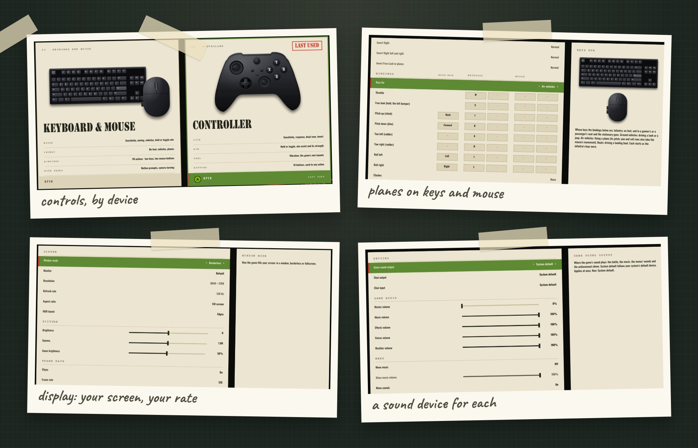

<table>
<tr>
<td width="50%" valign="top">

### Graphics
- **Presets** from Potato to Ultra, for integrated graphics up to fast cards, with the **spatial upscaler** on at
  Quality: NVIDIA NIS on an NVIDIA card that runs it, AMD FSR 1 on any other, with sharpening (AMD CAS)
- **Antialiasing**: FXAA, SMAA and Intel CMAA 2
- **Ambient occlusion** (Intel's XeGTAO) and **global illumination**
- **Shadows** up to four times the original, with **soft shadows** and **SSR reflections** on High and Ultra
- **Grass and shrubs**, placed from each level's own data, drawn as far as the whole map
- **Weather**: Lightning and Storm shake; **motion blur** and animation smoothing
- In detail: [docs/GRAPHICS-UPGRADES.md](docs/GRAPHICS-UPGRADES.md) and [docs/WEATHER-AND-SKY.md](docs/WEATHER-AND-SKY.md)

</td>
<td width="50%" valign="top">

### Display
- **Windowed or borderless**, the monitor, window size, resolution and **refresh rate**
- **Frame rate limit** from 30 to 240, or none, and **VSync**; **Future frame rendering** for more frames (off by default)
- **Ultrawide**: the game fills 21:9, 32:9 and other wide screens with a wider view, the HUD at the screen's sides or in
  the middle; or Letterbox 16:9
- **Field of view** on foot and in vehicles, camera shake, brightness and gamma, HUD scale and minimap size

</td>
</tr>
<tr>
<td valign="top">

### Controls
- **By device**: pick **Keyboard & Mouse** or **Controller** and see only its own settings and bindings, with a picture
  of your device and the chosen key or button lit up
- **Every key rebindable**, two keys and two mouse buttons for each action, with **bindings for each kind of vehicle**:
  Infantry, Ground vehicles, Air vehicles and Boats
- The **mouse aims** guns and turrets in every seat, **flies planes** (yaw, pitch and roll on any keys, buttons or the
  mouse, with their own sensitivity and invert), and looks around from a driver's or passenger's seat
- **Controllers** play as on the console, with the game's own layouts (Normal, Southpaw, Lefty), sensitivity, dead zone,
  inversion, vibration and remapping
- **Button prompts** for Xbox Series, PlayStation 3, PlayStation 5, Steam Deck or the keys, or the game's own Xbox 360
  style, changing as you switch between controller and keyboard

</td>
<td valign="top">

### Audio, Gameplay and Enhancements
- **Volume** for master, music, effects, voices and weather, menu music and sounds, the voiceover language
- **A device each** for game sound, chat output and chat input
- **The original menu sounds** in our menus, and **achievement popups** with their chime
- **Voice chat**: push to talk, open mic or off, voice volume and microphone sensitivity
- **The game in** English, French, German, Italian, Spanish or Japanese; aim assist, text chat, performance metrics,
  **Discord status**
- **Enhancements**: what Reborn adds to the game, such as the lettered flags

</td>
</tr>
</table>

<details>
<summary><b>The keys, on foot and in vehicles</b></summary>
<br>

Keyboard and mouse are on by default, beside any controller. Every key can be changed in Settings > Controls >
Keyboard & Mouse.

| Key | On foot | In a vehicle |
|---|---|---|
| <kbd>W</kbd> <kbd>A</kbd> <kbd>S</kbd> <kbd>D</kbd> | move | W throttle, S brake, A D turn |
| Mouse | look and aim | aim the guns and turret; look around from a driver's or passenger's seat; fly a plane |
| Left mouse button | fire | fire |
| Right mouse button | aim down sights | second weapon (bombs in a plane) |
| <kbd>Space</kbd> | jump | change seat |
| <kbd>E</kbd> | enter a vehicle, use, pick up | get out |
| <kbd>R</kbd> | reload | |
| <kbd>F</kbd> | draw knife (the Infantry class's wrench) | |
| <kbd>G</kbd> | grenade, explosives | free look in a plane |
| <kbd>Q</kbd> or the mouse wheel | switch weapon | second weapon (bombs in a plane) |
| <kbd>Shift</kbd> | sprint | |
| <kbd>C</kbd> or <kbd>Ctrl</kbd> | crouch | |
| <kbd>V</kbd> or <kbd>Up</kbd> | | vehicle camera (the bomb sight in the air raid) |
| <kbd>Tab</kbd> | command (tap), score (hold) | the same |
| <kbd>T</kbd>, <kbd>Y</kbd>, <kbd>U</kbd> | chat to everyone, your team, your squad | the same |
| <kbd>B</kbd> | push to talk (hold) | the same |
| <kbd>Esc</kbd> or <kbd>Enter</kbd> | the menu | the menu |
| <kbd>F2</kbd> | performance metrics | the same |

Planes: the mouse moves the stick. Left and right roll, forward and back pitch, and the stick springs back to the
centre when the mouse stops; W is the throttle, S the brake, A and D the rudder. On a controller planes fly as on the
Xbox 360: left trigger throttle, right stick pitch and roll, left stick rudder, right bumper bombs, left bumper free look.

</details>

<p align="center">
<a href="https://bf1943.tekrantgaming.com/guides/keyboard-and-mouse">Keyboard and mouse</a> &nbsp;·&nbsp;
<a href="https://bf1943.tekrantgaming.com/guides/controllers">Controllers</a> &nbsp;·&nbsp;
<a href="https://bf1943.tekrantgaming.com/guides/graphics">Graphics and display</a> &nbsp;·&nbsp;
<a href="https://bf1943.tekrantgaming.com/guides/voice-and-chat">Voice and text chat</a>
</p>

<a name="hosting-a-server"></a>

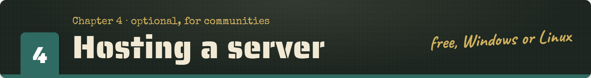

Hosting is for people who want servers of their own. It is free and optional: to play, you never need it.

<table>
<tr>
<td width="50%" valign="top"><br><b>Custom Match</b><br>For an evening with friends. Your game hosts a match on your PC while you play in it, online or on your LAN, with an optional password. No extra download.</td>
<td width="50%" valign="top"><br><b>Dedicated servers</b><br>For communities. The server package runs any number of servers on a Windows or Linux PC, with no window and no graphics card needed, around the clock, listed for everyone under Community.</td>
</tr>
</table>

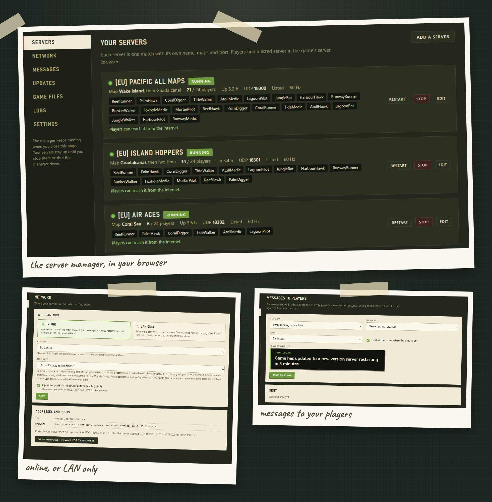

### What the server package includes
- **The server**: the game itself running as a dedicated server, playing your maps in turn. When a round ends the next
  map loads, and the players stay.
- **Its host**: links the players to the server, keeps it listed and passes on voice and text chat.
- **The server manager**: a page in your browser that installs the game from your package, runs your servers, restarts
  any that stop, messages your players and installs new releases, warning your players first.

### New for hosts in 0.4.8

| | | |
| :--- | :--- | :--- |
| <br>**Size, bots and tickets**<br>24, 32 or 64 players, bots for the empty slots, and automatic tickets for the size. [docs/SERVER-SIZES.md](docs/SERVER-SIZES.md) | <br>**Moderation**<br>Your own ban list, kicks, mutes, a player lookup and a log. [docs/MODERATION.md](docs/MODERATION.md) | <br>**Dashboard and community page**<br>Your servers live and over 90 days, and a public page with your own branding. [docs/DASHBOARD.md](docs/DASHBOARD.md) |

**Night Ops and Daybreak** switches on each server, and **F9** for your admins in the match: the time and weather,
Night Ops changes that hold for the round, and a free camera.

### What you need
- **Windows** 10, 11 or Windows Server, 64 bit (the package brings its own Python), or **64 bit Linux** with glibc 2.35
  or newer
- Your own copy of the game for Xbox 360, installed once
- **UDP ports** you can open: 18300 for the first server, 18301 for the next, and on

Hosting does not depend on the main backend: with **LAN only**, your servers run with a backend of their own and are
still online for anyone who joins by address with Direct Connect. The backend itself is open source, so a community can
run a whole network of its own. Listed community servers set their own rules, and must follow our
[terms](https://bf1943.tekrantgaming.com/terms) to stay listed.

<p align="center">
<a href="docs/SERVER.md"><b>The server guide</b></a> &nbsp;·&nbsp;
<a href="docs/LINUX-SERVER.md">Linux servers</a> &nbsp;·&nbsp;
<a href="https://bf1943.tekrantgaming.com/guides/server-ports">Ports and firewalls</a> &nbsp;·&nbsp;
<a href="https://bf1943.tekrantgaming.com/guides/running-your-server">Running your server</a> &nbsp;·&nbsp;
<a href="https://bf1943.tekrantgaming.com/hosting">Hosting, on the website</a>
</p>

<a name="fixing-problems"></a>

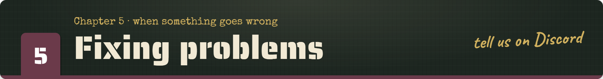

### Known issues

This is an alpha. The main ones:

- **Invisible players or black textures**: choose **Rebuild shaders** in Settings > Graphics.
- **Overlays** hooked into the game (OBS, Overwolf, RivaTuner and the like) can stop it joining or get in the way of its
  display: if you cannot load into a server, try without them.
- The first person weapon and hands move with the game's own updates, not every frame, at high frame rates (the view
  itself turns on every frame).
- Stats, awards and leaderboards count only on Reborn servers, and as this is an alpha they may still be reset.
- No HDR. On 16:10 and 4:3 screens Fill screen crops the picture's sides: Settings > Display > Aspect ratio >
  Letterbox 16:9 shows all of it.
- Voice chat has no echo cancelling: with Open mic, use headphones. Push to talk and the chat keys are keyboard keys:
  with a controller only (Steam Deck, ROG Ally), use Open mic, or map a back button to B in Steam Input.
- The builds are not code signed yet (see [Install on Windows](#install-on-windows)).

### Reporting a problem

Use **Report an issue** on the main menu: say what happened, tick what goes with it (your PC and settings, the end of
the log, a crash report, a screenshot), and send it from the game with no GitHub account, open it on GitHub with your
own, or copy it. A report that could not be sent is tried again at the next start. Or open an
[issue](https://github.com/TekRantGaming/Battlefield-1943-Reborn/issues) yourself with what you did, what you saw and
what you expected, your CPU and graphics card, and the files from `user\crashes` for a crash.

<p align="center">
<a href="https://bf1943.tekrantgaming.com/guides/wont-start">It will not start</a> &nbsp;·&nbsp;
<a href="https://bf1943.tekrantgaming.com/guides/cant-join">Cannot join a server</a> &nbsp;·&nbsp;
<a href="https://bf1943.tekrantgaming.com/guides/graphics-problems">Graphics problems</a> &nbsp;·&nbsp;
<a href="https://bf1943.tekrantgaming.com/guides/report-a-problem">Report a problem</a> &nbsp;·&nbsp;
<a href="https://bf1943.tekrantgaming.com/faq">FAQ</a>
</p>

### Privacy

- **Share graphics data** (on by default, Settings > Gameplay > Sharing) sends the graphics pipelines your game builds
  (render settings and shader numbers: no game files, no name, nothing about you) to our server, at most every 15
  minutes and only when something new was built, so the next update has them ready and everyone gets less stutter.
- Playing online, the backend sees the name you chose and your IP address, as any game server does. Your stats are
  kept under your soldier name.
- **Protect your name** needs no email or password, and your recovery code never leaves your PC: the game only proves
  it has the code. Keep a copy somewhere safe, as nobody else can give it back to you.
- **Report an issue** sends only what you ticked, and you see all of it first. Your user name, PC name, addresses,
  recovery code and email addresses are taken out before anything is sent.
- **Discord status** talks only to the Discord app on your own PC, and shows what you are playing, never a server
  address or another player's name. Turn it off in Settings > Gameplay.
- **The news window** reads our news from this repository on GitHub; its videos are YouTube's own player.
- **Voice and text chat** go through the server you play on: your voice only to the players near you, and only while
  you hold push to talk (or speak, with Open mic); the game opens your microphone only when you first use it. Servers
  keep a log of text chat for moderation; voice is passed on, never recorded.
- The game's own Telemetry setting changes nothing: its reports went to EA's servers, which are gone.
- Settings, logs and crash reports stay on your PC, in the folder `user`.

The whole policy: [Privacy](https://bf1943.tekrantgaming.com/privacy) and [Terms of service](https://bf1943.tekrantgaming.com/terms) on the website.

<a name="for-the-record"></a>

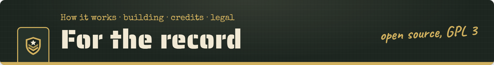

### How it works

- **Static recompilation.** The Xbox 360 program is translated ahead of time into native 64 bit code for Windows and
  Linux with the ReXGlue SDK (derived from the Xenia emulator), and runs on its runtime (`rexruntime.dll`, on Linux
  `librexruntime.so`), which stands in for the console's system services. The game's own code runs natively; it is
  not emulated.
- **NativeXRenderer.** The game's Xbox 360 graphics work is drawn with Vulkan by NativeXRenderer
  (`rexgpu-bfnative.dll`), with this project's additions: ambient occlusion, global illumination, grass, sharper and
  soft shadows, the sky, clouds and weather, the lights at night, and motion between the game's updates.
- **Online.** The game talked to EA's servers and Xbox LIVE. Reborn answers it with its own backend
  (`server\plasma.py`: login, server list, stats), and each dedicated server has a host (`server\gmhost.py`) that links
  players to it. A dedicated server is the game itself, run as a server with no window.
- **Our menus.** The first start setup, main menu, server browser, Custom Match, pause menu and settings are this
  project's own, drawn over the game, which keeps its own HUD.

<details>
<summary><b>Source code and building (for developers)</b></summary>
<br>

This repository holds the source code, next to the releases, the changelog and the guides. It contains no game files
and none of the game's code: the code generator translates the game's program on your PC, from your own copy.
Pull requests go to the **in-dev** branch; **main** holds the released code.

| Folder | What it holds |
|---|---|
| `bf` | The port itself: our menus and launcher, online services, the server mode, the renderer's game profile, and NativeXRenderer with our changes |
| `sdk/src-bf` | Our copy of the ReXGlue SDK, with its third party libraries |
| `server` | The backend and the dedicated server's host (Python) |
| `tools` | Packaging, the server package's scripts, the Linux build, and the helpers used to study the game |
| `docs` | The players' guides and the technical notes |

You need Visual Studio 2022 Build Tools with clang, CMake and Ninja, Git, Python 3.12, and your own copy of the game's
package.

```bat
git config --global core.longpaths true
git clone --recursive https://github.com/TekRantGaming/Battlefield-1943-Reborn.git
cd Battlefield-1943-Reborn
sdk\src-bf\build_bf.bat
python -I tools\stfs_extract.py "<your package file>" input\pkg
mklink /J bf\assets input\pkg
cd bf
..\sdk\src-bf\out\install\win-amd64\bin\rexglue.exe codegen bf1943_manifest.toml
build.bat bf-relwithdebinfo
```

The game is in `bf\out\build\bf-relwithdebinfo`. Linux builds run in WSL with the scripts in `tools/linux`. All the
steps: [BUILDING.md](BUILDING.md). Third party code and its licences: [THIRD_PARTY_NOTICES.md](THIRD_PARTY_NOTICES.md).

</details>

### Credits

1943 Reborn is made by **TekRantGaming** and contributors, with the players who test it and report problems.

- **[@ThatZaliaSGuy](https://github.com/ThatZaliaSGuy)**, the largest outside contributor (about 84% of the lines added
  by contributors' merged pull requests, as of 19 November 2026): ultrawide screens, mouse flying, free look in
  vehicles and the mouse in the game's own input ([pull request 11](../../pull/11)); the mouse in every vehicle seat,
  Custom Match with LAN, key bindings with two keys, HUD scale and minimap size, and the experimental tick rates
  ([pull request 16](../../pull/16)); Custom Match passwords, Iron Sight, motion blur and menu work
  ([pull request 20](../../pull/20)); the server stall diagnostics ([pull request 22](../../pull/22)); the sky, weather
  and wetness ([pull request 32](../../pull/32)); the hurricane, bots and Custom Match rules, 60 ticks as 30, vehicle
  key bindings and wetness, soft sun shadows and night lights ([pull request 62](../../pull/62)).
- **[@DiXN](https://github.com/DiXN)**: the big performance work, the renderer's own drawing thread, Future frame
  rendering, the audio crackling fix, the leaner Linux build and Wayland ([pull request 28](../../pull/28)).
- **[@SmokeDoggy044](https://github.com/SmokeDoggy044)**: Custom Match on Linux ([pull request 48](../../pull/48)) and
  sound fixes ([pull requests 52](../../pull/52), [57](../../pull/57), [60](../../pull/60) and [63](../../pull/63)),
  and a lock-free game clock ([pull request 58](../../pull/58)).
- **[@Erubadhron](https://github.com/Erubadhron)**: deploy map clicks that land where you click
  ([pull request 31](../../pull/31)).
- **[@Xarishark](https://github.com/Xarishark)**: installing the game from RecompLauncher ([pull request 70](../../pull/70)).
- **[@DicksonWu654](https://github.com/DicksonWu654)** (Dickson Wu, from SEAL & CertiK): reported an issue to us
  privately, fixed in 0.4.7.5.
- [**ReXGlue SDK**](https://github.com/rexglue/rexglue-sdk) (BSD 3 Clause), derived from
  [**Xenia**](https://github.com/xenia-project/xenia): the recompiler and runtime.
- **NativeXRenderer** by Gustavo Garcia (MIT): the Vulkan renderer. **GHMetalRecomp** (MIT): its NativeXRenderer
  profile, which ours started from.
- [**King Kong Recompiled**](https://github.com/TekRantGaming/king-kong-recompiled) by TekRantGaming and contributors
  (MIT): the ambient occlusion, global illumination and camera work, and much of what we learned.
- **DiligentCore** (Apache 2.0), **SPIRV Cross** (Apache 2.0), **volk** (MIT): the renderer's foundations.
- **XeGTAO** by Intel (MIT), **AMD FidelityFX** (MIT), **NVIDIA Image Scaling** (MIT) and **SMAA** (MIT style).
- **FFmpeg** (its decoders only) and **libmspack**, both LGPL 2.1, in the runtime. **vgmstream** (ISC): the layout of
  the game's menu music. **Oswald** (SIL Open Font Licence): the menus' font.
- Button prompts: **Input Prompts** by [Kenney](https://kenney.nl/assets/input-prompts) (CC0); our controller
  drawings in Settings > Controls follow its outlines. The Discord and Steam marks from **Simple Icons** (CC0).
- Add to Steam's artwork and More from TRG Studios' pictures from [**SteamGridDB**](https://www.steamgriddb.com),
  downloaded when used.
- This page's pictures are our own: the website's drawings and pictures of our own launcher and server manager, with
  made-up servers and names. Fonts in them: Saira Stencil One, IBM Plex Sans and Caveat (SIL Open Font Licence) and
  Special Elite (Apache 2.0).

Every download includes the full licence texts in its `licences` folder.

### Licence

The port's own code is free software under the **GNU General Public License, version 3 only** ([LICENSE](LICENSE)),
with an [additional permission](LICENSE-EXCEPTION.md) under section 7: it may be combined with the code recompiled from
the original game and the game's data, and with libraries whose licences are not compatible with the GPL, without
their source having to be given. Other people's code keeps its own licence, and the game itself is not covered. Until
25 November 2026 the port's own code was under the MIT licence: copies of 0.4.7.5 and earlier stay under it
([LICENSE-MIT-EARLIER.md](LICENSE-MIT-EARLIER.md)).

> [!NOTE]
> **AI disclosure:** this port was made almost entirely with Claude Code (Anthropic). The repository owner directed
> and tested the work; the AI did the analysis, code, tools and documentation.

> [!IMPORTANT]
> **1943 Reborn is an unofficial fan project** by TekRantGaming and contributors. It is not made, endorsed, sponsored or
> supported by Electronic Arts, DICE, Microsoft, Valve or Discord, and it is not affiliated with them. Battlefield and
> Battlefield 1943 are trademarks of Electronic Arts Inc.; they are named here only to say which game 1943 Reborn works
> with. All rights to the original game belong to their owners. The project contains no game files or game assets:
> everyone installs their own copy. Please do not share game files, and do not open issues asking for them.

<br>

<div align="center">
<a href="https://bf1943.tekrantgaming.com">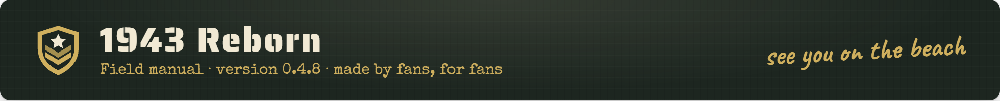</a>

**[Website](https://bf1943.tekrantgaming.com)** &nbsp;·&nbsp; **[Download](https://github.com/TekRantGaming/Battlefield-1943-Reborn/releases/latest)** &nbsp;·&nbsp; **[Discord](https://discord.gg/8eakYSvBZS)** &nbsp;·&nbsp; **[Changelog](CHANGELOG.md)** &nbsp;·&nbsp; **[Issues](https://github.com/TekRantGaming/Battlefield-1943-Reborn/issues)**
</div>
